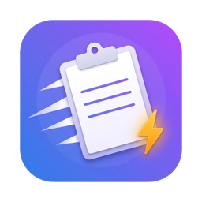

<div align="center">



# Pastora: a clipboard manager for Mac with Touch ID secure clips

**Free, open-source clipboard history for macOS, with drag-to-reorder pins and an encrypted vault for passwords and API keys.**

[Website](https://pankaj1980patel.github.io/pastora/) · [Download](https://github.com/pankaj1980patel/pastora/releases/latest) · [Build from source](#build-from-source) · [Roadmap](#roadmap)


</div>

Pastora runs in your Mac's menu bar and remembers everything you copy. Press **⌘⇧V** to search your history, paste a pinned snippet, or unlock a password with **Touch ID**. It's built with Rust and Tauri, so the app is under 10 MB, starts at login, and keeps everything on your device.

## Features

### 📋 Clipboard history
- Saves text, images, screenshots and copied files. Duplicates are merged and the copy moves to the top.
- Instant search, with keyboard navigation (`↑` `↓` `↩`) and quick paste (`⌘1`–`⌘9`).
- **Auto-paste** into the app you were using (needs Accessibility permission).
- Shows which app each item came from and when you copied it.
- History size limit (50 to unlimited) and age limit (1 day to forever).

### 📌 Pins
- Pin anything with `⌘P` and keep it forever.
- **Drag up or down to reorder**, or use `⌥↑` / `⌥↓`.
- Give pins a label, edit their text, or create one from scratch.

### 🔐 Secure Clips: an encrypted vault for credentials
- **Templates** for Login, API Key, Card, Wi-Fi, Server/SSH, Secure Note, or Custom key/value fields.
- **Unlock with Touch ID** or a master password.
- One-key copy: `↩` pastes the password, `⌘U` the username, `⌘T` a live **2FA / TOTP code**.
- **Username, then password**: `⌘L` pastes the username. Press the hotkey again to paste the password.
- Copied secrets are **cleared from the clipboard** after 30 seconds. They're marked *concealed*, so other clipboard managers skip them, and *current-host-only*, so they stay off Universal Clipboard.
- Built-in **password generator**, for random characters or memorable passphrases.
- Locks itself after inactivity, on sleep, and on screen lock. You can also hide the popup from screenshots and screen sharing.
- Encrypted backup export and import.

### ⚙️ Settings you control
- Change every global shortcut: open the popup, jump to Pins or Secure Clips, lock the vault, pause recording.
- Ignore apps (password managers are ignored by default) and ignore regex patterns, such as OTP codes, card numbers, AWS keys or private keys.
- Pause recording for 15 minutes, 1 hour, or until you resume.
- Themes (system, light, dark), popup size, text size, preview pane, and where the popup opens.
- Start at login, menu-bar-only or Dock icon, and export/import of settings and pins.

## Security

| What | How |
|---|---|
| Vault encryption | XChaCha20-Poly1305 with a random 256-bit vault key. Each entry is encrypted separately, and titles are encrypted too. |
| Master password | Argon2id (64 MiB, 3 passes) derives the key that wraps the vault key. |
| Touch ID | After biometric verification the vault key is read from the macOS Keychain. Your master password is still requested periodically. |
| Memory | The decrypted key stays in Rust memory and is zeroized when the vault locks. The UI only receives secret values when you copy or reveal one. |
| Network | None. Pastora makes no network requests and has no telemetry. |

Your data is stored in a SQLite database at `~/Library/Application Support/com.pastora.app/`, and it is kept across restarts.

## Install

1. Download **`Pastora_<version>_macOS_universal.dmg`** from the [latest release](https://github.com/pankaj1980patel/pastora/releases/latest). It's one download for both Apple Silicon and Intel Macs, macOS 11+.
2. Open the DMG and drag **Pastora** onto **Applications**.
3. Pastora isn't notarized by Apple yet, so macOS blocks it the first time. Either:
   - open **System Settings → Privacy & Security**, scroll down and click **Open Anyway** next to Pastora, or
   - run `xattr -dr com.apple.quarantine /Applications/Pastora.app` in Terminal.
4. Click the paw icon in the menu bar, or press **⌘⇧V**.

## Build from source

Requirements: macOS 11+, [Rust](https://rustup.rs) 1.77+, Node.js 20+, and the Xcode Command Line Tools.

```bash
git clone https://github.com/pankaj1980patel/pastora.git
cd pastora
npm install
npm run tauri dev          # run in development
npm run tauri build        # build Pastora.app and a .dmg
cd src-tauri && cargo test # run the Rust unit tests
```

## Keyboard shortcuts

| Shortcut | Action |
|---|---|
| `⌘⇧V` | Open clipboard history (can be changed) |
| `⌘⇧P` / `⌘⇧S` | Open Pins / Secure Clips |
| `⌘⇧L` | Lock Secure Clips |
| `↩` / `⌘↩` | Paste / copy the selected item |
| `⌘1`–`⌘9` | Paste item 1–9 |
| `⇥` | Next tab |
| `⌘P` · `⌘S` · `⌘⌫` | Pin · move to Secure Clips · delete |
| `⌥↑` `⌥↓` | Reorder pins |
| `⌘U` · `⌘T` · `⌘L` | Paste username · 2FA code · username then password |

## Roadmap

- [x] macOS: history, pins, Secure Clips, Touch ID, settings, start at login
- [ ] Linux (X11/Wayland, Secret Service, fprintd fingerprint)
- [ ] Windows (Windows Hello, Credential Manager, excluded from Win+V history)
- [ ] Signed and notarized releases with auto-update

## Tech stack

[Tauri 2](https://tauri.app) · Rust · React 19 · TypeScript · Tailwind CSS 4 · SQLite · dnd-kit

## License

[MIT](LICENSE)

---

<sub>Keywords: clipboard manager for Mac, macOS clipboard history, menu bar clipboard app, copy paste history, Touch ID password vault, secure clipboard, open-source Paste / Maccy / Raycast clipboard alternative, snippet manager, TOTP authenticator, Rust Tauri app.</sub>
